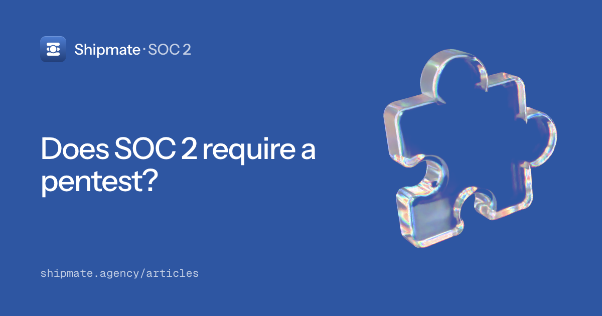

  

# Startup Security Questionnaire Answers (SIG Lite / VSA Starter Pack)

Honest, non-bluffing starter answers to the **18 enterprise security questionnaire questions** (SIG Lite / VSA / CAIQ) most often sent to lean SaaS teams running **Next.js, Supabase/Postgres, Vercel/Cloudflare, Stripe, and OpenAI/Anthropic**.

- **Customize with your stack & export CSV/Markdown:** https://shipmate.agency/tools/questionnaire-kit
- **Got hit with Row #14 (Pentest Letter)?** Inspect the public format first: https://shipmate.agency/sample-letter

## Rules Before Pasting Into a Buyer's Spreadsheet
1. **Never overclaim.** Keep only answers that accurately reflect your production system today.
2. **Customize placeholders** (`[Company]`, region, last test date).
3. **Unblock Row #14 fast:** If you don't have a third-party pentest letter yet, check whether your buyer accepts [Shipmate's 1-page attestation letter](https://shipmate.agency/sample-letter) (`$2,950 once`, target 5 business days).

## 18 Core Starter Answers
| # | Category | Question | Starter Answer (verify before sending) |
|---:|---|---|---|
| 1 | Hosting | Where is data hosted? | Web app on Vercel/Cloudflare (US/EU); data in managed Postgres (Supabase/RDS). |
| 2 | Transit | Encrypted in transit? | Yes — TLS 1.2+ enforced with HSTS; plaintext HTTP redirects to HTTPS. |
| 3 | Rest | Encrypted at rest? | Yes — AES-256 on database storage volumes and automated backups. |
| 4 | Isolation | Multi-tenant separation? | Enforced at API and DB layer (Postgres RLS / tenant ID scoping verified with two test accounts). |
| 5 | Access | Admin MFA? | Yes — MFA enforced on GitHub, cloud host, database console, and email. |
| 6 | Auth | Passwords & sessions? | Salted bcrypt/Argon2 hashing via auth provider; HttpOnly/Secure session cookies. |
| 7 | Secrets | Secrets management? | Encrypted host env vars only; never committed to Git; client env vars hold publishable keys only. |
| 8 | Payments | Card storage / PCI? | No card numbers stored; Stripe (PCI-DSS Level 1) handles billing with signed webhooks. |
| 9 | AI / LLMs | Model training on data? | Commercial zero-training LLM API tiers only; AI routes enforce auth, rate limits, and token caps. |
| 10 | SDLC | Code review? | Pull requests + automated security checks before deploy; staging separated from prod. |
| 11 | Packages | Dependency CVEs? | Continuous Dependabot / `npm audit` alerts; High/Critical patched on priority. |
| 12 | Logging | Security logging? | Auth events and errors retained in host/DB logs without logging passwords or secrets. |
| 13 | Backups | Backup cadence? | Automated daily backups with restore verification on staging. |
| 14 | **Pentest** | **Third-party pentest letter?** | Manual web app pentest completed on `[DATE]`; Critical/High fixed and retested. Letter attached. *([Need one fast?](https://shipmate.agency/sample-letter))* |
| 15 | SOC 2 | Current SOC 2 Type II? | Early-stage company without SOC 2 Type II yet; documented controls + recent pentest letter available. |
| 16 | Incidents | Breach notice SLA? | Investigated immediately; affected customers notified in writing without undue delay (≤72h where required). |
| 17 | Deletion | Data deletion on exit? | Primary records deleted on written request/termination; backups age out per retention policy. |
| 18 | Vendors | Subprocessor list? | Hosting, managed database, Stripe, and LLM provider; current list available on request. |

Part of **[Shipmate Open Source](https://github.com/Shipmate-agency)** · [`pentest-attestation-letter-template`](https://github.com/Shipmate-agency/pentest-attestation-letter-template) · [shipmate.agency](https://shipmate.agency)
